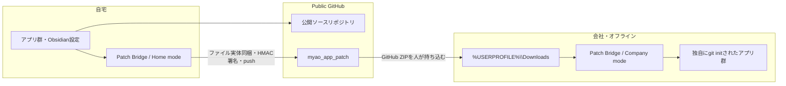
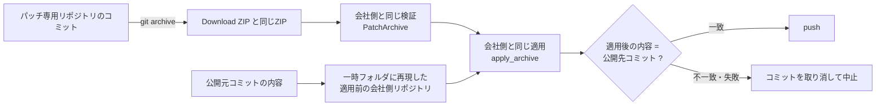
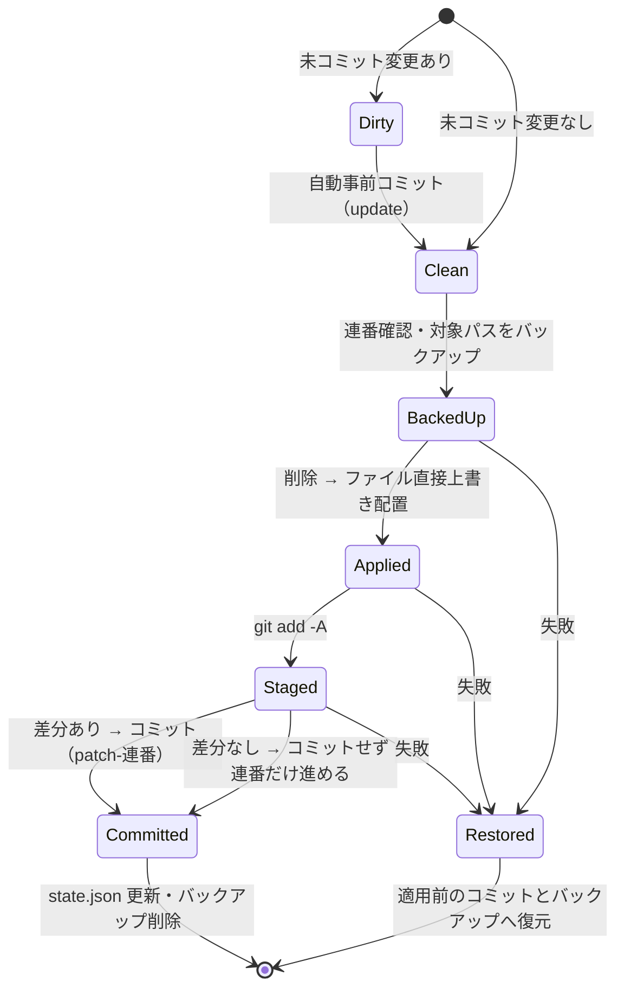

# 全体設計

## 目的

自宅で開発している公開Gitリポジトリの変更を、GitHubへ接続できず、独自に `git init` された会社側リポジトリへ安全に適用します。自宅と会社のコミットID・コミット履歴が一致しないため、履歴は移送しません。差分に含まれるファイルの実体と削除一覧をパッケージにして運び、会社側ではファイルを直接上書き配置・削除します。

## システム構成



Patch App本体のリポジトリと生成パッチ専用リポジトリは分離します。

```text
myao-patch-bridge      Patch App本体
myao_app_patch         生成パッチ専用
```

## 自宅側の状態

各リポジトリについて以下をローカル設定に保存します。

- 安定したリポジトリID
- 固定ブランチ
- 会社へ最初に導入済みのソースコミット
- 最後にパッチリポジトリへpushしたソースコミット（`published_commit`）
- 最後に発行したパッチ連番（`last_sequence`）
- 有効・無効
- 会社環境シミュレーション検証の除外パターン

pushが成功した時点で、自宅側では会社へ適用済みとして扱います。実際の適用実績を会社から持ち帰る処理はありません。

パッチ専用リポジトリの作業ツリーには最新のパッチだけを残すため（GitHubの「Download ZIP」を小さく保つため）、次の連番は自宅側設定の `last_sequence` から引き継ぎます。

設定の保存は一時ファイルへの書き出しと置換で原子的に行い、設定を書き換える操作は1つずつ順番に実行します。起動引数（`--host` / `--port` / `--allow-vpn`）による指定は起動中だけ有効で、設定ファイルには保存しません。

## 公開前リハーサル

パッケージを書き出してコミットした後、pushの前に、会社側の処理を自宅で実際に実行します（`rehearsal.py`）。



- ZIPは作業ツリーからではなく、**コミット済みの内容**から作ります。コミットから漏れたファイルや、同梱した `.gitattributes` による変換・除外は、作業ツリーを見ても分からないためです。
- 適用前の状態は、差分に関わるパスだけを公開元コミットの内容で配置して再現します。確認するパスは、マニフェストの記載に加えて、公開元と公開先のGitツリーを直接比べて求めます（マニフェストの届け漏れ・消し漏れを検出するため）。
- 会社側のGit設定や、会社側だけにあるファイルは再現できません。それらに起因する失敗は、会社側の適用トランザクション（下記）が復元します。

## 会社側の状態

会社側ではリポジトリごとに次のファイルを作ります。

```text
.git/rep-patch/state.json
```

Git管理対象外なので、手動コミットやPatch App更新の影響を受けません。保持するのは、最後に適用・確定したパッチ連番（`confirmed_sequence`）です。

適用中のバックアップは `.git/rep-patch/backups/` に作り、適用の成否にかかわらず終了時に削除します。

旧バージョン（適用後に未コミットのまま保持する方式）が残した `pending_sequences` を含む `state.json` も読み込めます。その場合は、次の適用またはコミット操作の際に未コミット分を `patch-連番` としてコミットし、確定済みへ取り込みます。

## 適用トランザクション



全アプリ適用はリポジトリ単位の独立トランザクションです。1つが失敗しても、そのアプリだけ適用前の状態へ復元し、他のアプリは続行します。`git apply` を使わずファイル実体を直接上書き配置・削除するため、会社側独自の変更や改行コード差分による適用失敗を回避します。

会社側で同じ修正を先に入れていたなど、パッチの内容が既に一致している場合は差分が生じません。この場合は失敗にせず、コミットを作らないまま適用済みとして連番を進めます。

パッケージごとに、削除を先に実行してからファイルを配置します。削除で空になったフォルダは片付けます。配置の際、同じフォルダに大文字小文字だけが違う名前のファイルがあれば、新しい名前へ改名してから書き込みます。これにより、大文字小文字だけの名前変更、ファイルからフォルダへの置き換え、フォルダからファイルへの置き換えを適用できます。

## React PWA / ネットワーク待受

- Reactのビルド成果物をPython APIと同梱
- 既定は `127.0.0.1:17345` のローカル固定オリジン
- 設定ドロワーまたは起動引数（`--allow-vpn` / `--host 0.0.0.0`）により、VPN（Tailscale等）やプライベートLANからの待受に対応
- Edge/Chrome等のブラウザからPWAとしてインストール可能
- Service Workerは静的UIだけをキャッシュ
- API、パス、ZIP、ログはキャッシュしない
- PWAを開く前にPythonバックエンドを起動する必要がある
- 接続元IPとHostヘッダーを全リクエストで検証（詳細は [セキュリティ設計](security.md)、フロー図は [network-access-flow.excalidraw](network-access-flow.excalidraw)）

## エディタ連携

- **自宅モード**: 各リポジトリカードからローカルのAntigravity（Antigravity IDE）を起動（`POST /api/open-antigravity`）
- **会社モード**: 各リポジトリカードからローカルのVS Codeを起動（`POST /api/open-vscode`）

